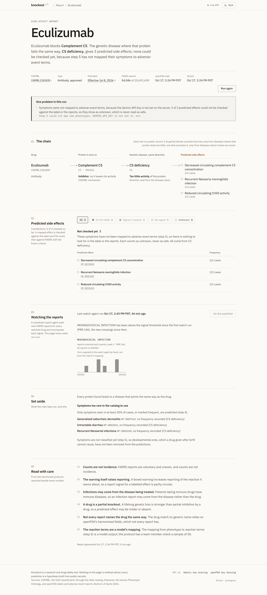

# Knockout


**Predict a drug's side effects from the genetic diseases of the proteins it blocks.**

Every genetic disease shows what happens when a person lives without one working protein. A drug
that blocks that protein is a chemical knockout, so it should cause a milder version of the same
disease. Knockout finds what a drug acts on, finds the genetic diseases where that protein fails the
same way, predicts side effects from their symptoms, and checks every prediction against the FDA
label and FDA adverse-event reports. A watch agent keeps checking as new reports arrive.

Built at LA Hacks AI Hackathon 2026, 17–18 Oct, UCLA. Track: **Applied Intelligence**.

|                       | Link                                   |
| --------------------- | -------------------------------------- |
| Ask it in ASI:One     | _fill in: ASI:One agent link_          |
| Agentverse profile    | _fill in: orchestrator profile URL_    |
| Report page           | _fill in: Vercel or custom-domain URL_ |
| API                   | _fill in: Vultr HTTPS URL_             |
| Creao watch agent run | _fill in: shared run link_             |
| Demo video (3:00)     | _fill in: video URL_                   |
| Devpost               | _fill in: Devpost project URL_         |

Knockout is a research and drug-safety tool. Nothing in it is medical advice, and a prediction is
a hypothesis built from public records.

---

## One example: eculizumab

| Step                | Record                                                                                                                                   | Source                                                                             |
| ------------------- | ---------------------------------------------------------------------------------------------------------------------------------------- | ---------------------------------------------------------------------------------- |
| The drug            | Eculizumab (CHEMBL1201828) is recorded as an **inhibitor** of complement C5 (UniProt P01031), so it lowers the protein's activity        | ChEMBL mechanism record                                                            |
| The genetic disease | C5 deficiency. Its name says the protein does too little, which is the same direction as the drug                                        | IUIS classification, through the Helix catalog                                     |
| Its symptom         | "Recurrent Neisseria meningitidis infection", HP:0005381, seen in 2 of 2 reported cases                                                  | HPO annotations (OMIM:609536)                                                      |
| The label           | Boxed warning: "SERIOUS MENINGOCOCCAL INFECTIONS"                                                                                        | openFDA label, set id `ebcd67fa-b4d1-4a22-b33d-ee8bf6b9c722`, effective 8 Jul 2026 |
| The reports         | 86 of 54,046 eculizumab reports name meningococcal infection, against 311 of 20,692,690 reports for all drugs. PRR 146, Yates χ² 8,852.7 | openFDA FAERS, data last updated 30 Jul 2026                                       |

The proportional reporting ratio (PRR) says how much more often a reaction is reported with this
drug than with every other drug. 146 passes the Evans criteria for a signal (PRR ≥ 2, at least 3
reports, χ² ≥ 4).

**Where this stands.** The engine produces the first three rows by itself on live data today. The
last two were checked by hand on 17 Oct 2026 with the engine's own label-match and counting code,
with the reaction term `MENINGOCOCCAL INFECTION` supplied by us. The engine reaches the verdict by
itself only once step 5 (Gemini) maps HP:0005381 to reaction terms, which needs `GEMINI_API_KEY`;
until then the live report lists the prediction under "Not checked yet".
_fill in once step 5 runs: the engine's own verdict for HP:0005381 and the terms Gemini proposed._

## How it works

The eight steps are fixed in [`benchmark/PROTOCOL.md`](benchmark/PROTOCOL.md) (version 2).

1. **Drug to targets.** ChEMBL mechanism records for the drug's parent molecule, salt forms
   included. Only human single-protein targets are used. Each action type is read as `lowers`,
   `raises` or `unknown`.
2. **Targets to genetic diseases.** Each target's diseases come from the Helix catalog of the IUIS
   classification of inborn errors of immunity (604 diseases, 511 genes). A disease's direction comes
   from the mechanism IUIS states, then from Orphanet product 6 ("loss of function" or "gain of
   function"), then from the words of its name ("deficiency").
3. **The direction rule.** A drug that lowers a protein uses only that protein's diseases with too
   little activity (loss of function, haploinsufficiency, dominant negative). A drug that raises a
   protein uses only its gain-of-function diseases. Every other pairing is shown as "points the
   other way" and never used. This rule is code; no model decides it.
4. **Diseases to symptoms.** A symptom is predicted when the catalog marks it Obligate, Very
   frequent or Frequent, or reports it in at least 30% of cases. Rarer symptoms are listed under "Set
   aside" on the report page.
5. **Symptoms to reaction terms.** Gemini, once per phenotype, at temperature 0, sees only the HPO id
   and label, never a drug. It returns the kind (clinical, laboratory or developmental) and up to five
   MedDRA terms, the vocabulary FAERS records reactions in. A term is kept only if FAERS holds at
   least one report with it. The mappings are committed to `data/mappings/hpo.json`, and scored runs
   read only that file. Developmental symptoms are dropped, because a drug given after birth cannot
   cause them.
6. **Label check.** The most recent openFDA label, sections `boxed_warning`, `warnings_and_cautions`,
   `warnings`, `precautions` and `adverse_reactions`. A prediction is on the label when a sentence
   contains one of its terms as a whole phrase. The sentence is kept verbatim. No model takes part.
7. **Report check.** FAERS totals through openFDA give the 2×2 table, the PRR and the Yates χ².
8. **Verdict.** `on_label`, `signal_in_reports`, `no_signal` or `unknown`. A clinical prediction
   with a report signal and no label mention is a **candidate new signal**.

```
drug ──► targets and direction ──► genetic diseases that fail the same way ──► their symptoms
        (ChEMBL action type)       (direction rule: blocks ↔ loss of function,     │
                                    activates ↔ gain of function)                  ▼
                                                                  adverse-event terms (Gemini)
                                                                           │
                                     ┌─────────────────────────────────────┴───────────┐
                                     ▼                                                 ▼
                              FDA label check                              FDA adverse-event reports
                     (sentence quoted verbatim)                      (PRR ≥ 2, ≥ 3 reports, χ² ≥ 4)
                                     └────────────────────┬────────────────────────────┘
                                                          ▼
                         on_label · signal_in_reports · no_signal · unknown
```

- **Unknown is never safe.** Too few reports to tell, or a source that failed, gives `unknown`, and
  the page and the agents say so.
- **No prediction without evidence.** Each prediction carries its records: the ChEMBL mechanism,
  the catalog entry, the direction source, the phenotype and the label sentence. With the Tiger Data
  store, a database trigger refuses to commit a prediction with no evidence row. The JSON file store
  (the default when `DATABASE_URL` is empty) does no such check.
- **Directions in the catalog.** Of the catalog's 583 gene–disease pairs, IUIS states a mechanism
  for 77, Orphanet product 6 supplies one for 61 more, and the disease name for 328. 464 pairs end
  with a usable direction (415 too little activity, 49 too much). 119 have none, including 2 IUIS
  neomorphs of IRF4, and are never used. Counted with `knockout.genetics` on 17 Oct 2026.

## Architecture

```
       ASI:One chat                                    Browser
            │                                             │
   Fetch.ai agents on Agentverse mailboxes      Report page (Next.js, on Vercel)
   orchestrator + 4 specialists                           │
            └────────────────────┬────────────────────────┘
                                 ▼
               Knockout API (FastAPI, on Vultr)  ◄─────── Creao watch agent (scheduled)
                 │                      │                 POST /api/webhooks/creao/signals
                 ▼                      ▼
          engine (Python)      store: Tiger Data (TimescaleDB) or JSON files
                 │
   ChEMBL · Helix IUIS catalog · Orphanet · HPO · Gemini · openFDA labels and FAERS
```

| Folder          | What                                                                        | Runs on                          |
| --------------- | --------------------------------------------------------------------------- | -------------------------------- |
| `src/knockout/` | The engine (steps 1 to 8), the API, both stores, Sentry instrumentation     | Python 3.14                      |
| `benchmark/`    | The frozen protocol, the drug-set generator, scoring and the results report | Python 3.14                      |
| `db/`           | The Tiger Data schema and the evidence-trigger demo                         | TimescaleDB 2.30.2, Postgres 17  |
| `agents/`       | The five Fetch.ai uAgents                                                   | Python 3.12 (uAgents 0.25.5)     |
| `creao/`        | The watch agent's script (`watch.py`), the API trigger and the Creao guide  | Python, `httpx` only             |
| `web/`          | The report page                                                             | Next.js 16, React 19, TypeScript |
| `deploy/`       | Docker images, Compose for Vultr, Caddy for HTTPS                           | Docker                           |
| `tests/`        | Engine, failure, API, store and benchmark tests                             | pytest                           |

The API, all under `/api` (interactive docs at `/api/docs`):

| Endpoint                           | Returns                                                                        |
| ---------------------------------- | ------------------------------------------------------------------------------ |
| `GET /api/health`                  | `status`, whether the Gemini and openFDA keys are set, and which store is live |
| `GET /api/drugs/{name}/report`     | The engine report and `cached_at`; `?refresh=true` reruns the engine           |
| `GET /api/drugs/{name}/trend`      | Reports received per quarter for each watched term, and the last run time      |
| `GET /api/drugs/{name}/alerts`     | Terms that crossed the signal threshold since the previous watch run           |
| `GET`, `POST /api/watchlist`       | The watched drugs (at most 10)                                                 |
| `POST /api/webhooks/creao/signals` | The watch agent's counts; needs the `X-Knockout-Webhook-Secret` header         |

When `KNOCKOUT_WEBHOOK_SECRET` is set, `POST /api/watchlist` and `?refresh=true` need the same
header, so a public deployment cannot spend the openFDA or Gemini quota.

## Built at LA Hacks

The hackathon rules allow open-source prior work when the new features are stated. Knockout uses
[Helix](https://github.com/dheerajkoppu/helix) (MIT), built at Hack-Nation on 3 Oct 2026 and pinned
here to commit `97f3704` from 4 Oct 2026, as a library.

**Reused from Helix:** exactly three imports, plus one copied list.

- `helix.knowledge.catalog` (`load_catalog`, `Catalog`): the IUIS catalog of 604 diseases and 511
  genes, with its HPO and Orphanet phenotypes;
- `helix.discovery.subject.resolve_mechanism`: a disease's stated or named mechanism;
- `helix.discovery.rules.molecule_effect`: a ChEMBL action type read as lowers or raises;
- the agents carry a copy of Helix's lists of lowering and raising action types, because they run on
  Python 3.12 and cannot import Helix.

**Built at LA Hacks:** everything else in this repository.

- the ChEMBL client (drug to parent molecule, mechanisms filed on any salt form, targets) and the
  evidence records;
- the drug-first pipeline and the direction rule for side effects;
- Orphanet product 6 gain or loss of function as a new direction source;
- the phenotype frequency filter, the Gemini phenotype-to-reaction mapping, the verbatim label check
  and the FAERS signal test;
- the benchmark protocol, the drug-set generator, the shuffled baseline and the scoring report;
- the API, the Tiger Data store with its evidence trigger, and the JSON file store;
- the five Fetch.ai agents, the Interactive Card and the Payment Protocol flow;
- the Creao watch agent and its webhook;
- the report page, the Sentry instrumentation and the Vultr deployment.

## Measured results

The protocol was frozen as version 1 on 17 Oct 2026, then revised to version 2 the same day, before
any measure was computed. Each change and its reason is listed in the file. The scoring script has
run, but it stops at step 5 without the Gemini key and has computed no number.

**The drug set** (`benchmark/drug_set.json`, generated by script under version 2 from ChEMBL_37 and
Helix `97f3704`, never edited by hand):

| Step                                                                        | Kept             |
| --------------------------------------------------------------------------- | ---------------- |
| 1. Catalog genes with a UniProt accession and a disease of known direction  | 407 of 511 genes |
| 2. ChEMBL mechanism records on a human single protein, for an approved drug | 118 records      |
| 3. The drug's effect matches one of the gene's disease directions           | 57 molecules     |
| 4. openFDA holds a label for the drug                                       | 52 drugs         |
| Drugs in the set with a boxed warning                                       | 18               |

**The measures:**

| Measure                                        | Result                                   | n   |
| ---------------------------------------------- | ---------------------------------------- | --- |
| Predicted effects confirmed on the label       | not measured: step 5 mapping not run yet | –   |
| Predicted effects with a signal in the reports | not measured: step 5 mapping not run yet | –   |
| Lift over shuffled diseases (100 shuffles)     | not measured: step 5 mapping not run yet | –   |
| Boxed warnings predicted                       | not measured: step 5 mapping not run yet | –   |
| Candidate new signals                          | not measured: step 5 mapping not run yet | –   |

_fill in once scored: each row from `benchmark/results/RESULTS.md`, label precision first, with the
caveats below beside it._ The current `benchmark/results/` files come from a run under version 1 on
the earlier 39-drug set (525 predictions, none mapped); the next `benchmark.score` run replaces them.

## Agents

### Fetch.ai (Agentverse and ASI:One)

| Agent                   | Address   | Does                                                                                                     |
| ----------------------- | --------- | -------------------------------------------------------------------------------------------------------- |
| `knockout-orchestrator` | _fill in_ | Reads the request in ASI:One, resolves the drug, calls the four specialists, returns an Interactive Card |
| `target-agent`          | _fill in_ | Steps 1 and 2: the drug's targets and which way it pushes each one                                       |
| `genetics-agent`        | _fill in_ | Steps 3 to 5: genetic diseases, their direction and source, the frequent symptoms and reaction terms     |
| `label-agent`           | _fill in_ | Step 6: the label sentence that names each effect, verbatim                                              |
| `signal-agent`          | _fill in_ | Steps 7 and 8: FAERS counts, PRR, χ², the verdict, and the watch agent's trend and alerts                |

The orchestrator speaks the Agent Chat Protocol (0.3.0) and is the seller in the Agent Payment
Protocol (0.1.0). The whole workflow runs inside one ASI:One chat: ask "What side effects should a
C5 blocker cause?" or "Is eculizumab expected to cause infections?". The orchestrator resolves a
protein question through UniProt and ChEMBL to the approved drugs on that target, analyses the
longest-marketed one and offers the others as buttons.

- **Failure handling.** Every specialist answers whatever breaks. A source failure or a timeout
  becomes `unknown` with its reason, and the reply names the agent and the protocol step while still
  showing what the other specialists returned. In the local run below it read "label-agent (step 6)
  and signal-agent (steps 7 and 8) answered unknown: no prediction has reaction terms yet".
- **Payment.** The summary is free. "Full report" sends a payment request for 0.1 FET (testnet by
  default). The orchestrator checks the transaction on the Fetch.ai ledger before sending every
  target, prediction, quote, count, trend and alert. It is tested against transaction bodies shaped
  like the ledger API's response, not yet against a live ASI:One wallet payment.
- **Run locally on 17 Oct**, through all five agents against the live API, the question "What side
  effects should a C5 blocker cause?" returned: ChEMBL lists 5 approved drugs that inhibit complement
  C5; the analysis of eculizumab (first approved 2007) with its chain to C5 deficiency and 3
  predicted effects, each `unknown` because step 5 has not run; and a card with "Full report · 0.1
  FET", "Check ravulizumab" and "Check avacincaptad pegol sodium".

Setup, Agentverse mailboxes and the ASI:One Submission Agent are in
[`agents/README.md`](agents/README.md).

### Creao watch agent

- Agent ID: _fill in_
- Run: _fill in: share link to one run_

On a schedule, the agent runs [`creao/watch.py`](creao/watch.py) for every drug on the watchlist.
It counts FAERS reports for each predicted reaction term quarter by quarter, recomputes the PRR and
the Evans criteria, and posts the run to `POST /api/webhooks/creao/signals`. Every trend bar and
threshold alert on the report page, and the trend in the signal-agent's answer, comes only from its
posts: remove the agent and nothing is monitored. Adding a drug to the watchlist starts a run
through the Creao API Trigger when `CREAO_API_KEY` and `CREAO_AGENT_ID` are set on the server.
Building it in Creao is in [`creao/AGENT.md`](creao/AGENT.md).

Measured locally on 17 Oct (openFDA data last updated 30 Jul 2026): for eculizumab and
`MENINGOCOCCAL INFECTION` over 8 quarters, 37 openFDA requests and about 85 s without a key. Reports
received per quarter from 2024Q3 to 2026Q2 were 0, 1, 0, 2, 1, 0, 2, 0; the cumulative PRR at 2026Q2
is 146, a signal. That term was passed by hand with `--term`, because step 5 has not run; the page
captions such a chart "Term supplied to the watch agent by hand".

## Store: Tiger Data

[`db/schema.sql`](db/schema.sql) is applied by the API at startup when `DATABASE_URL` is set, and
every statement in it can run again safely.

- `drugs`, `reports`, `predictions`, `evidence`, `watchlist`, `signal_runs` and `alerts`.
- `faers_counts` is a hypertable on the quarter, with old quarters moved to the columnstore by a
  compression policy.
- `faers_trend` is a continuous aggregate: per drug, term and quarter, the count from the latest run
  that measured it. The trend chart reads it.
- A deferred constraint trigger on `predictions` fails any transaction that commits a prediction
  with no `evidence` row, and a second trigger stops evidence being removed from a prediction that
  stays. [`db/demo_trigger.sql`](db/demo_trigger.sql) shows the refusal and changes nothing.
- An alert is a term whose latest-quarter signal was false in the drug's previous run and is true in
  this one, so the first run is the baseline and never alerts.

Tested against a local TimescaleDB 2.30.2 container (`docker compose up -d timescaledb`). Tiger
Cloud: _fill in: service region, once `DATABASE_URL` points at it_. Without `DATABASE_URL`, the API
uses JSON files under `data/store/` with the same methods and the same alert rule.

## Report page

`/drug/<name>` on the web page shows one drug: the chain drug → protein → disease → effects, each
link a public record; the predictions grouped by verdict; the label quote set like the label, with
a boxed warning in a black rule box; the 2×2 table behind each PRR with the Evans criteria checked
one by one; the watch agent's last run and per-quarter bars; what the rules set aside and why; and
the caveats. Verdicts differ by shape (filled, half, hollow, dashed square) so they read without
colour, and the one accent colour marks only where the label or the reports agree with the
genetics. Checked at 1440 px and 390 px, light and dark.



The screenshot is the live API on 17 Oct 2026: the chain is complete, and the three predictions are
"Not checked yet" because step 5 has not run. `/drug/eculizumab?fixture=1` shows a development
fixture whose meningococcal row was filled in by hand from the facts above; the page labels it
FIXTURE. More in [`web/README.md`](web/README.md).

## Observability: Sentry

Nothing is sent unless `SENTRY_DSN` is set.

- **API and CLI:** tracing and logs through the FastAPI integration, one span per ChEMBL or openFDA
  lookup marked with whether the disk cache answered it.
- **AI agent monitoring:** each Gemini call is a `gen_ai.chat` span with the model, temperature,
  prompt, answer and token counts; the phenotype mapper is a `gen_ai.invoke_agent` span. The prompt
  holds only HPO ids and labels.
- **Agents:** each chat is an `invoke_agent` transaction with a span per specialist.
- **Web:** Session Replay and browser tracing on the report page.
- API keys are scrubbed from every event, span and log before it leaves (`api_key=` and `key=`
  become `[Filtered]`).

_fill in: a link or screenshot of one trace and the AI agent monitoring view, once a DSN is set._

## Deploy

[`deploy/README.md`](deploy/README.md): one Vultr Cloud Compute instance in Los Angeles runs the
API and the agents with Docker Compose, Caddy gets the HTTPS certificate, and the agents reach
Agentverse through mailboxes, so no inbound port is opened for them. The report page runs on Vercel
and calls the API from the browser. The store for the submission is Tiger Cloud.

- API: _fill in: Vultr HTTPS URL_
- Domain: _fill in: GoDaddy Registry domain_

## Run it

[`RUNBOOK.md`](RUNBOOK.md) has every command in order and the variables each part reads; `make help`
lists the shortcuts.

```bash
make setup                          # .venv (Python 3.14), the package with its API extras, then `knockout setup`
cp .env.example .env                # set GEMINI_API_KEY and OPENFDA_API_KEY; optional DATABASE_URL, KNOCKOUT_WEBHOOK_SECRET, SENTRY_DSN
make test                           # 122 pass; 11 store tests skip without a database
make api                            # http://127.0.0.1:8000/api/docs
make predict DRUG=eculizumab        # also writes data/reports/eculizumab.json
```

Optional parts:

```bash
docker compose up -d timescaledb    # local TimescaleDB on 127.0.0.1:5433; set DATABASE_URL to it in .env
make web                            # report page on http://localhost:3000 against the local API
make agents                         # the five agents (Python 3.12, own venv); seeds in agents/.env
.venv/bin/python creao/watch.py --dry-run --drug eculizumab --term "MENINGOCOCCAL INFECTION"
make benchmark                      # the scored run, reading only committed mappings
```

The agents read `agents/.env` (seeds from `python -m knockout_agents.seeds`) and the web page reads
`web/.env.local` (`NEXT_PUBLIC_API_URL`).

## What is real and what is simulated

| Real, read live                                                                                                  | Simulated or chosen by hand                                                                                                                        |
| ---------------------------------------------------------------------------------------------------------------- | -------------------------------------------------------------------------------------------------------------------------------------------------- |
| ChEMBL targets and action types, the IUIS catalog, Orphanet directions, the direction rule, the frequency filter | The page's `?fixture=1` report: its meningococcal row (reaction term and counts) was filled in by hand from the live facts above; labelled FIXTURE |
| openFDA labels and FAERS totals, the label match and the PRR in the eculizumab example                           | The reaction term in that example, `MENINGOCOCCAL INFECTION`, was supplied by us, because step 5 has not run                                       |
| The watch agent's quarterly counts and PRRs, computed from live openFDA                                          | The term it watched for eculizumab was passed by hand with `--term`; the page captions it as chosen by hand                                        |
| The agents' chat flow, run locally through all five agents with real uAgents messages                            | The Payment Protocol, tested only against transaction bodies shaped like the ledger API's, not a live wallet                                       |
| The evidence trigger, on a local TimescaleDB                                                                     | _fill in: anything else simulated in the final demo_                                                                                               |

No prediction, count or benchmark number in this repository or on the page was made up to fill a
gap. Where the pipeline is blocked, it says `unknown` and why.

## Verified, and not yet

**Verified on 17 Oct 2026:**

- The engine on live ChEMBL, catalog and openFDA data: eculizumab gives 1 target, 1 disease and 3
  predictions; ibrutinib 37 predictions; ruxolitinib 19.
- The API on both stores, including the Postgres store on a local TimescaleDB.
- The report page against the live API, at 1440 px and 390 px.
- The five agents in one local process, answering from the live API.
- The watch script posting to the local API (8 quarters stored, 0 alerts on the first run, which is
  the baseline).
- The tests: 122 passed and 11 skipped without a database (133 pass with the local TimescaleDB);
  agents 22 passed; `ruff check` clean; the web page type-checks and builds.

**Not yet:**

- Step 5, which needs `GEMINI_API_KEY`: until it runs, every verdict is `unknown` and no benchmark
  number exists.
- Agentverse registration and an ASI:One chat; a live FET payment.
- A Creao scheduled run.
- The Vultr and Vercel deployment, Tiger Cloud, and any Sentry event.

## Limits

- The catalog covers inborn errors of immunity only, so Knockout predicts side effects for drugs
  acting on immune-system genes, and the drug set is made of those drugs.
- A drug with no ChEMBL mechanism on a single human protein gets no prediction. Tofacitinib is one:
  ChEMBL files its mechanism on a protein family.
- Most diseases' direction comes from the words of their name, which is weaker than a stated
  mechanism; the report shows the source for each disease.
- FAERS reports are voluntary and uneven, and counts are not incidence.
- A boxed warning raises reporting of the reaction it warns about, so a report signal for a labelled
  effect is partly circular.
- Patients on immune drugs have immune diseases, so an infection report can come from the disease
  rather than the drug.
- A lifelong genetic loss is stronger than partial inhibition by a drug, so predicted effects may be
  milder or absent.
- Developmental and congenital symptoms are excluded, because a drug given after birth cannot cause
  them.
- Step 5 is a model's mapping. The protocol has a team member check a sample of 50.

## Sponsor challenges entered

| Challenge                         | How Knockout uses it                                                                                                      |
| --------------------------------- | ------------------------------------------------------------------------------------------------------------------------- |
| Fetch.ai: ASI:One Agent Challenge | Five agents on Agentverse; the whole workflow in one ASI:One chat; Interactive Card; Payment Protocol for the full report |
| Creao AI: Best AI-First Disruptor | The watch agent produces all the monitoring the product shows: the trend, the alerts and the signal slice                 |
| Paper: Best Designed Hack         | The report page's type, verdict shapes and label-style quotes. Paper file: _fill in_                                      |
| Cognition: Devin                  | _fill in: the bounded tasks Devin did, with session links_                                                                |
| Sentry                            | Tracing, Logs, AI agent monitoring (`gen_ai` spans on Gemini and the agents) and Session Replay                           |
| MLH: Tiger Data                   | FAERS counts as a hypertable, the trend as a continuous aggregate, the evidence trigger                                   |
| MLH: Gemini API                   | Classifying phenotypes and mapping them to FDA reaction terms (step 5)                                                    |
| MLH: Vultr                        | One instance runs the API and the agents with Docker Compose                                                              |
| MLH: GoDaddy Registry             | _fill in: the domain_, serving the API and the report page                                                                |
| MLH: Commit Fellowship            | Opted in on Devpost, with the supplemental form                                                                           |

## Team

_fill in: names and roles_

## Data and licence

Code: MIT. Data keeps the terms of its source: ChEMBL, Orphanet, the Human Phenotype Ontology,
UniProt, openFDA and the IUIS classification, each listed with its terms and citation in
[`ATTRIBUTION.md`](ATTRIBUTION.md).
